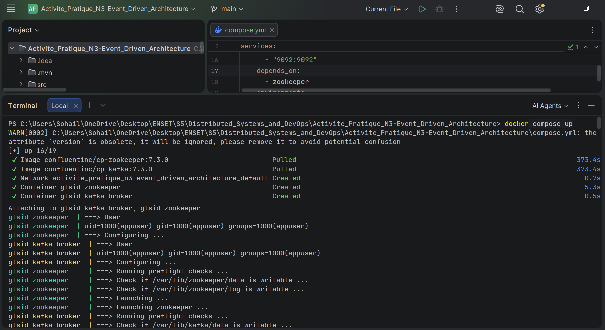
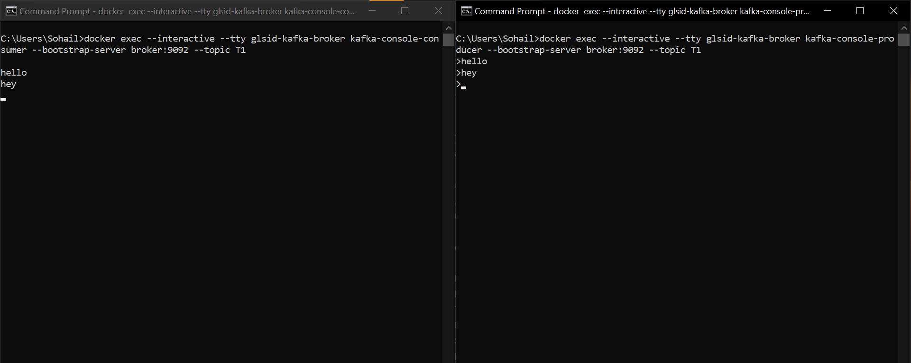
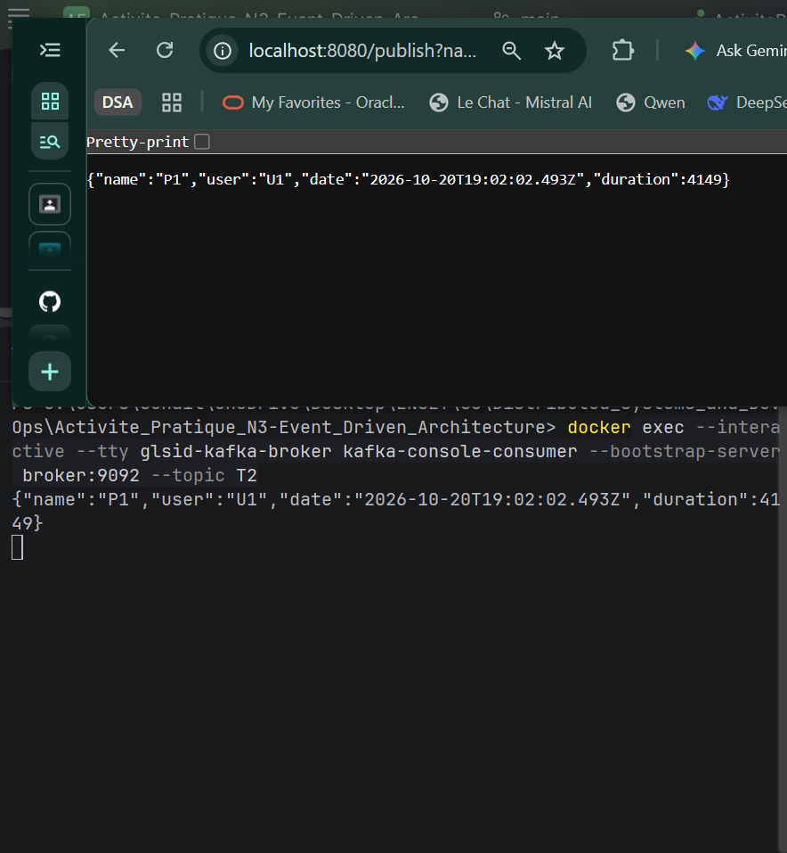
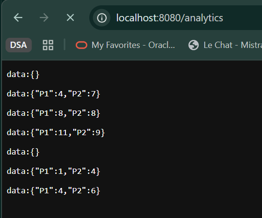
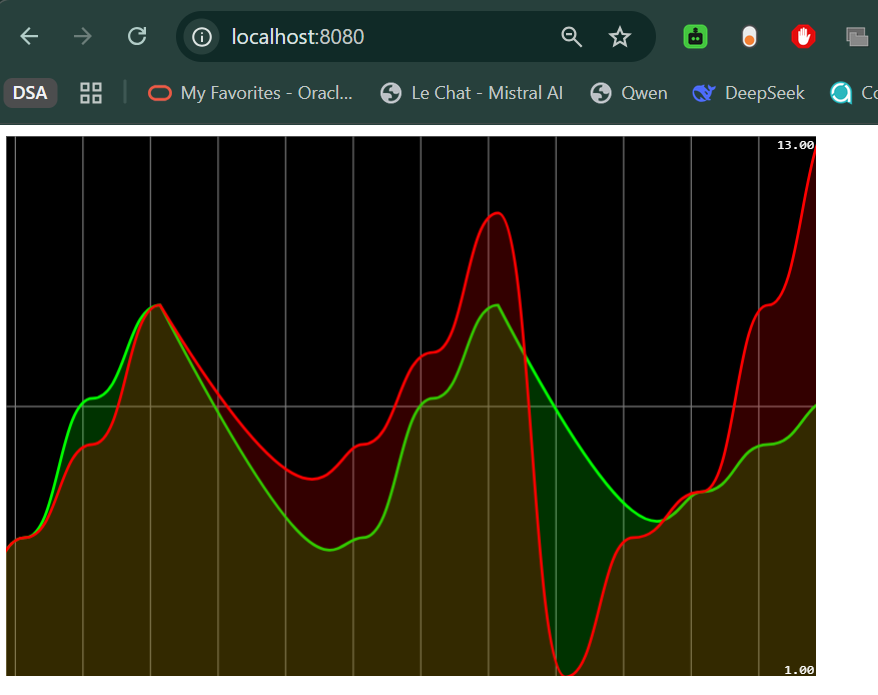
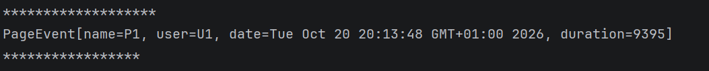
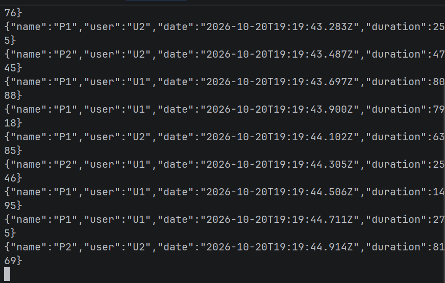

# Activité pratique N°3 : Event-Driven Architecture avec Kafka

## Objectif

Mettre en place une architecture orientée événements avec Apache Kafka et
Spring Cloud Stream afin de produire, consommer et analyser des événements en
temps réel.

L'application manipule des `PageEvent` contenant un nom de page, un utilisateur,
une date et une durée. Les événements sont agrégés par fenêtre de cinq secondes
avec Kafka Streams, puis affichés dans un graphique web en temps réel.

## Partie pratique réalisée

### 1. Kafka en installation locale

- Télécharger Kafka.
- Démarrer ZooKeeper.
- Démarrer le serveur Kafka.
- Tester Kafka avec `kafka-console-producer` et `kafka-console-consumer`.

### 2. Kafka avec Docker

- Créer le fichier `compose.yml`.
- Démarrer les conteneurs ZooKeeper et Kafka Broker.
- Tester le producer et le consumer depuis le conteneur Kafka.

### 3. Application Spring Cloud Stream

- Service Producer Kafka exposé par un contrôleur REST.
- Service Consumer Kafka basé sur une fonction `Consumer`.
- Service Supplier Kafka basé sur une fonction `Supplier` périodique.
- Traitement analytics temps réel avec Kafka Streams.
- Application web affichant les résultats du traitement en temps réel.

## Ressource pédagogique

- [Vidéo de la partie pratique](https://www.youtube.com/watch?v=8uY7JE_X_Fw&authuser=0)
- [Quickstart Kafka avec Docker et Confluent](https://developer.confluent.io/quickstart/kafka-docker/)

## Architecture des flux

```text
PageEvent
	│
	├── REST /publish?name=P1&topic=T2
	│       └──> topic T2 ──> Consumer Kafka
	│
	└── Supplier périodique ──> topic T3
										 └──> Kafka Streams
												  ├── fenêtre de 5 secondes
												  ├── comptage par page
												  └── topic T4 / count-store

Dashboard web <── Server-Sent Events ── /analytics
```

## Topics Kafka

| Topic | Utilisation                                                                              |
| ----- | ---------------------------------------------------------------------------------------- |
| `T1`  | Topic utilisé pour les tests manuels avec la console Kafka.                              |
| `T2`  | Événements envoyés par le contrôleur REST et consommés par `pageEventConsumer`.          |
| `T3`  | Événements produits périodiquement par `pageEventSupplier` et traités par Kafka Streams. |
| `T4`  | Résultats du comptage Kafka Streams.                                                     |

## Technologies

- Java 21
- Spring Boot
- Apache Kafka
- Kafka Streams
- Spring Cloud Stream
- Spring Cloud Stream Kafka Binder
- Spring Cloud Stream Kafka Streams Binder
- Spring Web MVC
- Docker Compose
- Maven
- Smoothie.js pour le graphique temps réel

## Prérequis

- Java 21
- Docker Desktop avec Docker Compose
- Maven 3.8+ ou le Maven Wrapper fourni
- Un terminal permettant d'exécuter les commandes Kafka dans le conteneur

## Démarrage de Kafka avec Docker

Depuis le dossier du projet :

```powershell
docker compose -f compose.yml up -d
```

Vérifier l'état des conteneurs :

```powershell
docker ps
```

Arrêter l'infrastructure Kafka :

```powershell
docker compose -f compose.yml down
```

## Tests avec les consoles Kafka

Ouvrir deux terminaux. Dans le premier, démarrer le consumer :

```powershell
docker exec --interactive --tty glsid-kafka-broker kafka-console-consumer --bootstrap-server broker:9092 --topic T1
```

Dans le second, démarrer le producer :

```powershell
docker exec --interactive --tty glsid-kafka-broker kafka-console-producer --bootstrap-server broker:9092 --topic T1
```

Saisir un message dans le producer et vérifier qu'il apparaît dans le
consumer.

## Démarrage de l'application

Lancer l'application Spring Boot depuis ce dossier :

```bash
./mvnw spring-boot:run
```

Sous Windows :

```powershell
.\mvnw.cmd spring-boot:run
```

L'application écoute sur le port `8080`.

## API et dashboard

Publier un événement dans le topic choisi avec le contrôleur REST :

```text
http://localhost:8080/publish?name=P1&topic=T2
```

Le endpoint retourne l'événement JSON créé. Pour observer les analytics au
format Server-Sent Events :

```text
http://localhost:8080/analytics
```

Le dashboard web est disponible à la racine :

```text
http://localhost:8080/
```

Il écoute `/analytics` et affiche les compteurs des pages `P1` et `P2` dans
une fenêtre glissante de cinq secondes.

## Configuration Spring Cloud Stream

Les bindings principaux sont définis dans
`src/main/resources/application.properties` :

```properties
pageEventConsumer-in-0 -> T2
pageEventSupplier-out-0 -> T3
kStreamFunction-in-0 -> T3
kStreamFunction-out-0 -> T4
```

Le supplier publie automatiquement un événement toutes les `200 ms` et le
store Kafka Streams `count-store` est interrogé par l'endpoint `/analytics`.

## Captures d'écran

### Démarrage de ZooKeeper et Kafka avec Docker



### Producer et consumer Kafka en console



### Publication d'un événement avec l'API REST



### Résultats de l'analytics en temps réel



### Dashboard web Kafka Streams



### Messages reçus par le consumer



### Événements produits par le supplier



## Tests Maven

```bash
./mvnw test
```

## Structure du projet

```text
.
├── compose.yml                         # ZooKeeper et Kafka Broker
├── src/main/java/                      # Producer, consumer, supplier et streams
├── src/main/resources/application.properties
├── src/main/resources/static/index.html # Dashboard temps réel
├── media/                              # Captures de l'activité
└── README.md
```
