# Activité pratique N°4 : Architecture CQRS et Event Sourcing avec Axon Framework et Spring Boot

## Objectif

Cette activité consiste à concevoir et implémenter un microservice de gestion de comptes bancaires en appliquant les patterns architecturaux **CQRS** (*Command Query Responsibility Segregation*) et **Event Sourcing** à l'aide de **Spring Boot**, **Axon Framework**, **PostgreSQL** et **Docker**.

Le système sépare strictement la chaîne de traitement des commandes d'écriture (Command Side) et le modèle de lecture optimisé pour les requêtes (Query Side). Toutes les modifications d'état sont persistées de manière immuable sous forme d'événements dans un **Event Store**, avec une synchronisation continue des projections en base de données et une diffusion en temps réel via des **Server-Sent Events (SSE)**.

## Énoncé et réalisations

1. **Infrastructure Docker** : Déploiement conteneurisé d'une base de données **PostgreSQL 17** et de l'interface d'administration **pgAdmin 4** via Docker Compose.
2. **Configuration Axon Framework** : Paramétrage des sérialiseurs Jackson (événements et objets généraux) et XStream (messages).
3. **Partie Commande (Command Side & Event Sourcing)** :
   - Définition des commandes : `CreateAccountCommand`, `CreditAccountCommand`, `DebitAccountCommand` et `UpdateAccountStatusCommand`.
   - Définition des événements du domaine : `AccountCreatedEvent`, `AccountActivatedEvent`, `AccountCreditedEvent`, `AccountDebitedEvent` et `AccountStatusUpdatedEvent`.
   - Implémentation de l'agrégat `AccountAggregate` (`@Aggregate`, `@CommandHandler`, `@EventSourcingHandler`, `@AggregateIdentifier`).
   - Implémentation des règles de gestion métier : validation de soldes positifs, vérification de l'activation du compte pour les opérations, contrôle du solde lors des débits et transition des statuts (`CREATED`, `ACTIVATED`, `SUSPENDED`, `BLOCKED`).
   - Contrôleur REST `AccountCommandController` utilisant le `CommandGateway` pour dispatcher les commandes et exposant un endpoint pour rejouer/consulter le flux brut des événements depuis l'`EventStore`.
4. **Partie Requête (Query Side & Projections)** :
   - Entités de lecture JPA : `Account` et `AccountOperation` (`OperationType.CREDIT`, `OperationType.DEBIT`).
   - Projections avec `AccountEventHandler` (`@EventHandler`) : consommation asynchrone des événements pour synchroniser la base de données de lecture relationnelle.
   - Requêtes métier : `GetAllAccountsQuery`, `GetAccountStatementQuery` et `WatchEventQuery`.
   - Gestionnaire de requêtes `AccountQueryHandler` (`@QueryHandler`).
   - Contrôleur REST `AccountQueryController` exploitant le `QueryGateway`.
   - Streaming réactif en temps réel (*Subscription Query*) avec `QueryUpdateEmitter` et `Flux<AccountOperation>` vers le client sous format SSE.
5. **Documentation & Validation** :
   - Génération de la documentation interactive OpenAPI / Swagger UI.
   - Validation des règles métier et tests des endpoints REST.
   - Vérification de l'Event Store et des tables de projection dans PostgreSQL via pgAdmin.

## Architecture CQRS & Event Sourcing

```text
                      ┌──────────────────────────────────────────────┐
                      │              Client HTTP / REST              │
                      └──────────────┬──────────────────┬────────────┘
                                     │                  │
                Commandes (Ecriture) │                  │ Requetes (Lecture & SSE)
                                     ▼                  ▼
                         ┌───────────────────┐  ┌───────────────────┐
                         │  CommandGateway   │  │   QueryGateway    │
                         └─────────┬─────────┘  └─────────┬─────────┘
                                   │                      │
                                   ▼                      ▼
                         ┌───────────────────┐  ┌───────────────────┐
                         │ AccountAggregate  │  │AccountQueryHandler│
                         └─────────┬─────────┘  └─────────▲─────────┘
                                   │                      │
                          Emet des │                      │ Lit
                         evenements│                      │
                                   ▼                      │
                         ┌───────────────────┐            │
                         │    Event Store    │            │
                         │   (PostgreSQL)    │            │
                         └─────────┬─────────┘            │
                                   │ Propage              │
                                   │ les evenements       │
                                   ▼                      │
                         ┌───────────────────┐            │
                         │AccountEventHandler│            │
                         │   (Projections)   │            │
                         └─────────┬─────────┘            │
                                   │ Met a jour           │
                                   ▼                      │
                         ┌───────────────────┐            │
                         │ Base de Lecture   ├────────────┘
                         │ (Account & Oper.) │
                         └─────────┬─────────┘
                                   │ queryUpdateEmitter
                                   ▼
                         ┌───────────────────┐
                         │   Flux SSE /watch │
                         └───────────────────┘
```

## Technologies

- Java 21
- Spring Boot 4.1.2
- Axon Framework 4.13.1
- PostgreSQL 17
- pgAdmin 4
- Spring Data JPA
- Spring Web MVC
- Project Reactor (Reactor Core)
- Springdoc OpenAPI / Swagger UI 3.2.0
- Lombok
- Docker & Docker Compose
- Maven

## Prérequis

- Java 21
- Docker Desktop avec Docker Compose
- Maven 3.8+ ou le Maven Wrapper fourni
- Un navigateur web ou un client d'API (cURL, Postman)

## Démarrage de PostgreSQL et pgAdmin avec Docker

Lancer les conteneurs depuis le dossier du projet :

```powershell
docker compose up -d
```

Pour arrêter les conteneurs :

```powershell
docker compose down
```

### Paramètres de connexion pgAdmin

Ouvrir [http://localhost:8088](http://localhost:8088) :

- **Email** : `admin@gmail.com`
- **Mot de passe** : `admin`

Paramètres du serveur PostgreSQL dans pgAdmin :
- **Host name/address** : `postgres` (ou `localhost` si accès direct hors réseau conteneur)
- **Port** : `5432`
- **Maintenance database** : `es-accounts_db`
- **Username** : `admin`
- **Password** : `1234`

## Démarrage de l'application

Lancer l'application Spring Boot depuis ce dossier :

```bash
./mvnw spring-boot:run
```

Sous Windows :

```powershell
.\mvnw.cmd spring-boot:run
```

L'application démarre sur le port `8066`.

## Endpoints et API

### Documentation interactive Swagger UI

- Swagger UI : [http://localhost:8066/swagger-ui/index.html](http://localhost:8066/swagger-ui/index.html)

### 1. Command Side (`/commands/accounts`)

| Méthode | Endpoint                               | Description                                          |
| ------- | -------------------------------------- | ---------------------------------------------------- |
| `POST`  | `/commands/accounts/add`               | Créer un nouveau compte bancaire                     |
| `POST`  | `/commands/accounts/credit`            | Créditer un compte existant                          |
| `POST`  | `/commands/accounts/debit`             | Débiter un compte existant                           |
| `PUT`   | `/commands/accounts/updateStatus`      | Mettre à jour le statut du compte                    |
| `GET`   | `/commands/accounts/events/{accountId}`| Lire l'historique brut des événements du compte      |

#### Exemples de requêtes de commande

**Création d'un compte** :
```json
POST /commands/accounts/add
Content-Type: application/json

{
  "initialBalance": 50000.0,
  "currency": "MAD"
}
```

**Créditer un compte** :
```json
POST /commands/accounts/credit
Content-Type: application/json

{
  "accountId": "VOTRE_ACCOUNT_ID",
  "amount": 3000.0,
  "currency": "MAD"
}
```

**Débiter un compte** :
```json
POST /commands/accounts/debit
Content-Type: application/json

{
  "accountId": "VOTRE_ACCOUNT_ID",
  "amount": 2000.0,
  "currency": "MAD"
}
```

**Modifier le statut d'un compte** :
```json
PUT /commands/accounts/updateStatus
Content-Type: application/json

{
  "accountId": "VOTRE_ACCOUNT_ID",
  "status": "SUSPENDED"
}
```

### 2. Query Side (`/query/accounts`)

| Méthode | Endpoint                               | Description                                                      |
| ------- | -------------------------------------- | ---------------------------------------------------------------- |
| `GET`   | `/query/accounts/all`                  | Lister l'ensemble des comptes projetés en base de données       |
| `GET`   | `/query/accounts/statement/{accountId}`| Consulter le relevé et l'historique des opérations d'un compte   |
| `GET`   | `/query/accounts/watch/{accountId}`    | Flux Server-Sent Events (SSE) notifiant les opérations en direct |

## Captures d'écran

### 1. Enregistrement du serveur PostgreSQL dans pgAdmin

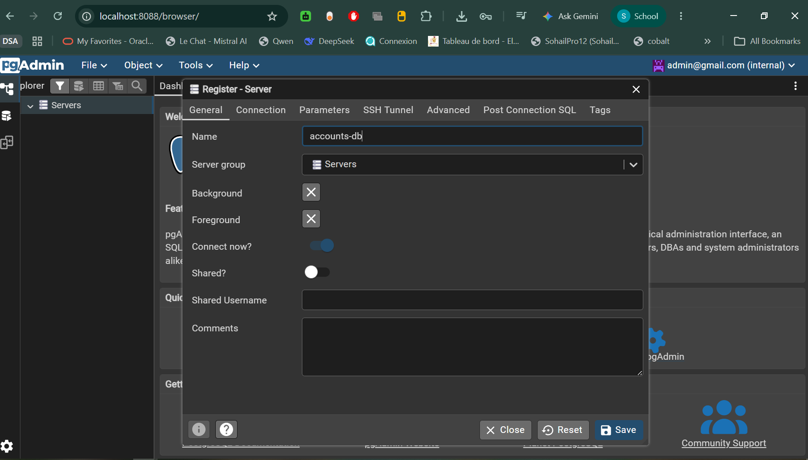

### 2. Paramètres de connexion à PostgreSQL

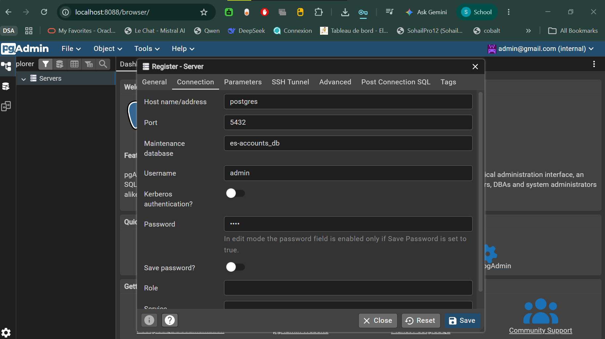

### 3. Tableau de bord pgAdmin et tables générées par Axon

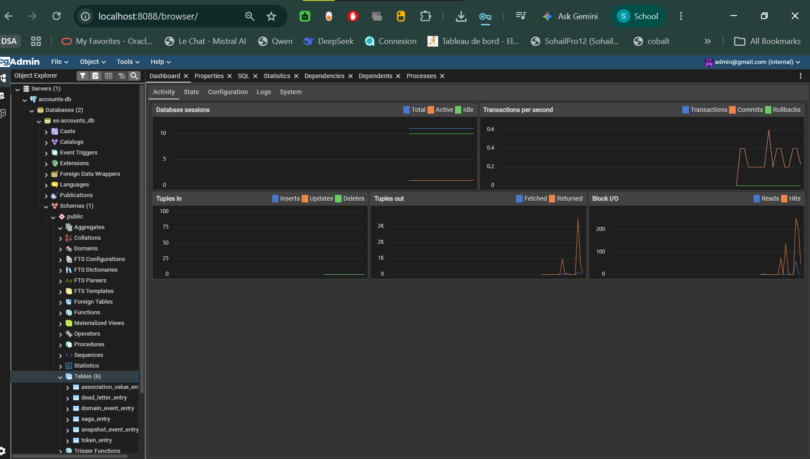

### 4. Interface Swagger UI

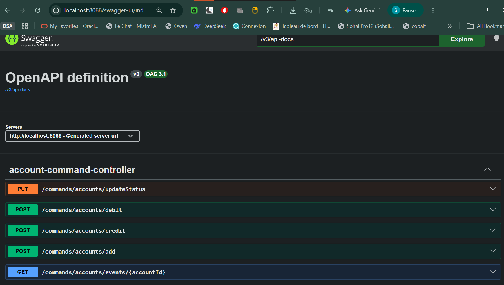

### 5. Table `domain_event_entry` (Event Store) dans PostgreSQL

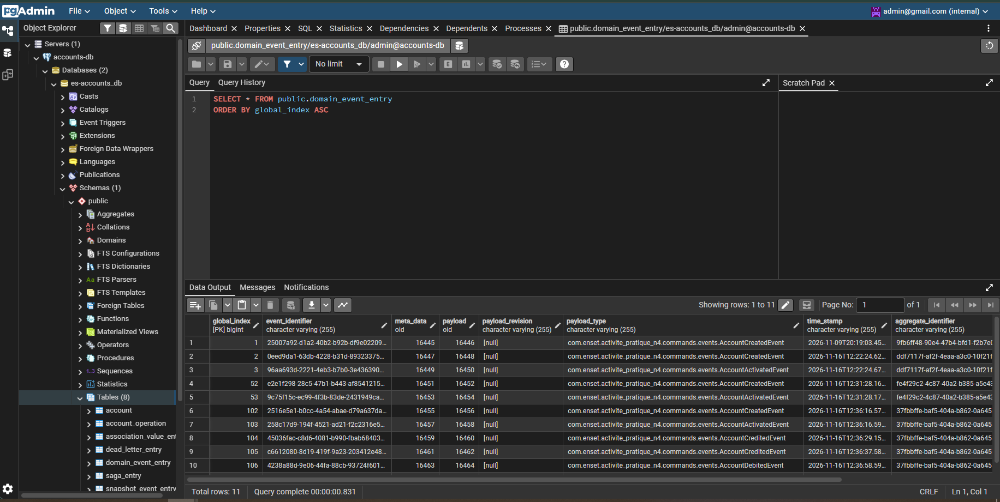

### 6. Événements du compte retournés par l'Event Store

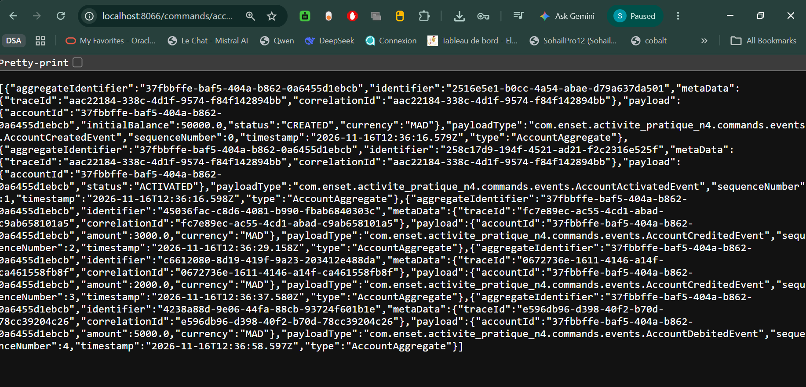

### 7. Table de projection `account` (Query Side)

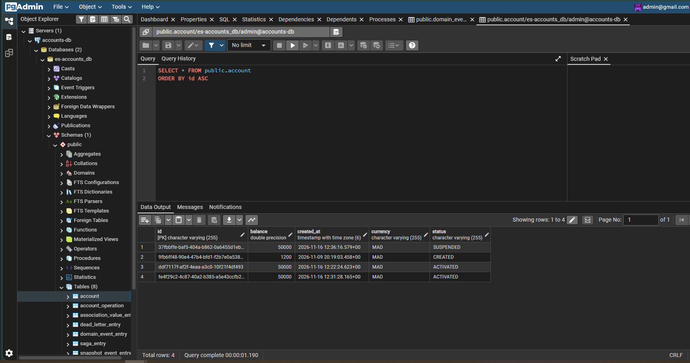

### 8. Table de projection `account_operation` (Opérations)

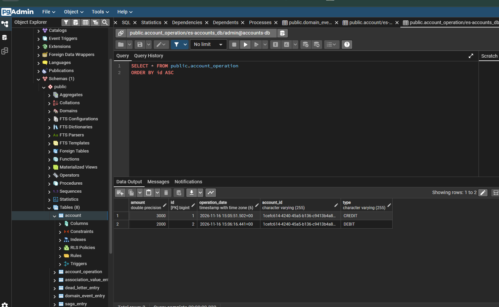

### 9. Mise à jour du statut d'un compte via Swagger

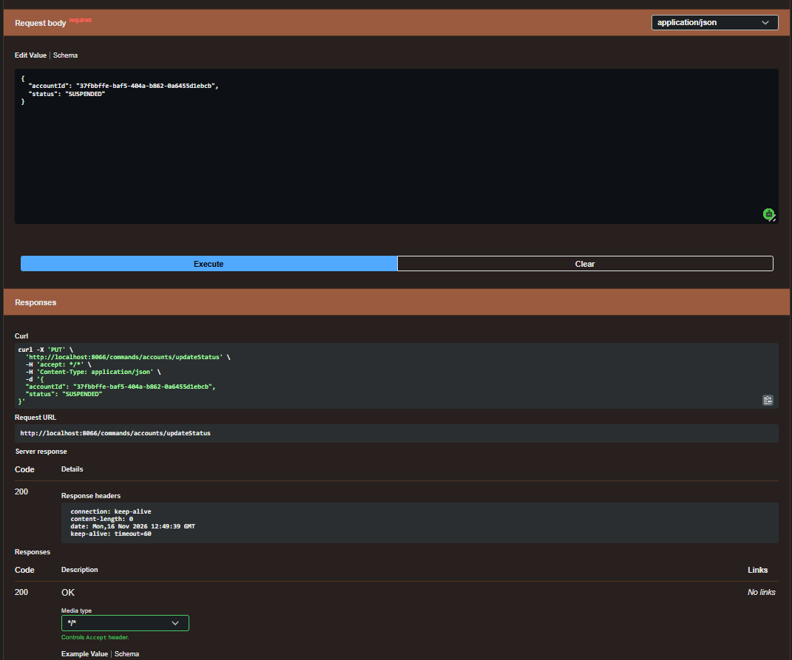

### 10. Validation des règles métier (échec du débit sur compte suspendu)

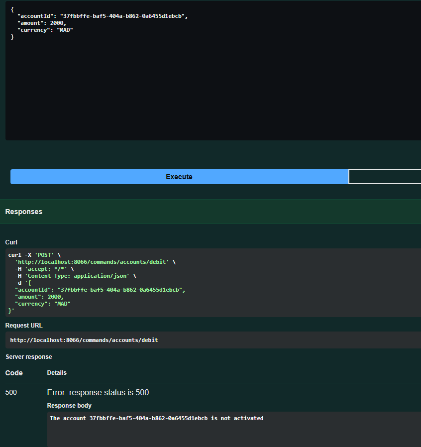

### 11. Streaming réactif en temps réel (Server-Sent Events)

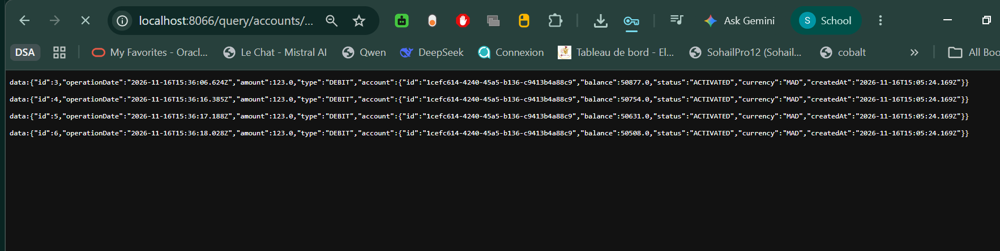

## Tests Maven

Pour exécuter les tests :

```bash
./mvnw test
```

Sous Windows :

```powershell
.\mvnw.cmd test
```

## Structure du projet

```text
.
├── compose.yml                                       # Définition des services PostgreSQL et pgAdmin
├── pom.xml                                           # Dépendances Spring Boot, Axon Framework et PostgreSQL
├── src/
│   ├── main/
│   │   ├── java/com/enset/activite_pratique_n4/
│   │   │   ├── commands/                             # Command Side (Écriture & Métier)
│   │   │   │   ├── aggregates/                       # Agrégat Axon (AccountAggregate)
│   │   │   │   ├── commands/                         # Définitions des Commandes
│   │   │   │   ├── controllers/                      # AccountCommandController
│   │   │   │   ├── dto/                              # DTOs pour les commandes
│   │   │   │   └── events/                           # Événements du domaine
│   │   │   ├── common/                               # Énumérations partagées (AccountStatus, OperationType)
│   │   │   └── query/                                # Query Side (Lecture & Projections)
│   │   │       ├── controllers/                      # AccountQueryController (REST & SSE Flux)
│   │   │       ├── dto/                              # DTOs pour les requêtes
│   │   │       ├── entities/                         # Entités JPA (Account, AccountOperation)
│   │   │       ├── handlers/                         # Event Handlers & Query Handlers
│   │   │       ├── queries/                          # Définitions des Requêtes
│   │   │       └── repositories/                     # Interfaces Spring Data JPA
│   │   └── resources/
│   │       └── application.properties                # Configuration de la datasource et des sérialiseurs Axon
│   └── test/java/                                    # Tests unitaires et d'intégration
├── media/                                            # Captures d'écran illustrant le fonctionnement
└── README.md
```

